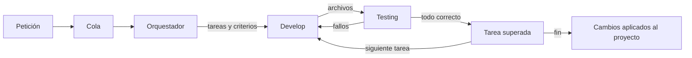

# Agent Trio

Consola interna para una empresa de software a medida. Permite gestionar los proyectos de varios clientes en paralelo con un equipo de tres agentes de IA y ver en directo qué hace cada agente, en qué estado está cada tarea y qué código está cambiando.

## Qué permite hacer

- Ver todos los proyectos en un tablero con su cliente, fase, tarea actual y progreso.
- Lanzar la misma petición sobre uno o varios proyectos. Se ejecutan en paralelo y el resto espera en cola.
- Abrir un proyecto en un espacio tipo IDE con archivos, diff, código en streaming y vista previa.
- Revisar el historial de ejecuciones, las comprobaciones de cada tarea y la actividad global.

## Cómo funciona



| Agente | Proveedor | Modelo por defecto | Función |
| --- | --- | --- | --- |
| Orquestador | Gemini AI Studio | `gemini-3.6-flash` | Divide la petición en tareas con criterios verificables |
| Develop | Groq | `openai/gpt-oss-120b` | Crea o modifica los archivos de cada tarea |
| Testing | OpenRouter | `nvidia/nemotron-3.5-super-vl:free` | Revisa el código tras las comprobaciones automáticas |
| Respaldo | Mistral | `codestral-latest` | Continúa si un proveedor falla o agota su cuota |

Testing combina dos capas. Primero compila el proyecto generado con el compilador de TypeScript en modo estricto y analiza su AST: rutas, componentes, textos, enlaces rotos, estructura, dependencias y etiquetas de formulario. Si todo pasa, un modelo revisa el código. Cada tarea admite hasta tres intentos.

## Decisiones técnicas

- **Motor reanudable:** cada paso de agente es una petición corta que guarda su estado en Neon, compatible con los límites de funciones de Vercel.
- **Cola paralela:** los pasos se reservan con `FOR UPDATE SKIP LOCKED` y una concesión con caducidad. Un índice único impide dos ejecuciones activas en el mismo proyecto. El paralelismo se ajusta con `MAX_PARALLEL_RUNS`.
- **Código en directo:** Develop usa salida estructurada en streaming y guarda borradores parciales que la consola muestra casi en tiempo real.
- **Aislamiento de cambios:** cada ejecución trabaja sobre su propia copia. El proyecto solo se actualiza cuando todas las pruebas pasan.
- **Resiliencia:** los errores de cuota o disponibilidad pasan al modelo de respaldo y después se reintentan con espera.
- **Vista previa de Next.js:** los componentes TSX generados se ejecutan en el navegador con un runtime propio que resuelve el App Router, `next/link`, `next/image` y `next/navigation`. Es una simulación ligera: no ejecuta funciones de servidor ni un build completo de Next.js.
- **Seguridad:** toda la consola requiere sesión, las claves solo existen en variables de entorno y hay un límite diario. El código generado nunca se ejecuta en el servidor: se muestra en un iframe aislado con CSP, sin acceso a red ni a la aplicación.
- **Accesibilidad:** interfaz orientada a WCAG 2.2 AA, con navegación por teclado, foco visible, estados anunciados a lectores de pantalla, modo oscuro, movimiento reducido y seguimiento automático desactivable.

## Limitaciones conocidas

- Para no depender de procesos de pago, el motor avanza mientras haya una sesión de la consola abierta. Si se cierra, las ejecuciones quedan en pausa y continúan al volver.
- Los proyectos son espacios de trabajo de demostración guardados en la base de datos, no repositorios reales.
- Los planes gratuitos de los modelos limitan el volumen diario de ejecuciones.

## Stack

Next.js 16, React 19, TypeScript, Tailwind CSS 4, AI SDK, Neon Postgres, Drizzle ORM, Vitest, Playwright y axe-core.

## Puesta en marcha

```bash
pnpm install
cp .env.example .env.local
pnpm db:migrate
pnpm db:seed
pnpm dev
```

`AUTH_SECRET` debe tener al menos 32 caracteres. `DEMO_USER` y `DEMO_PASSWORD` definen el usuario de prueba.

## Verificación

```bash
pnpm lint
pnpm typecheck
pnpm test
E2E_BASE_URL=http://localhost:3000 pnpm test:e2e
```

Las pruebas end-to-end auditan WCAG 2.2 AA con axe en 320, 768 y 1440 px, en tema claro y oscuro, además del login, la protección de la API, la vista previa y la navegación por teclado. La auditoría automática no sustituye una revisión manual con lector de pantalla.

## Uso de Claude Code

La aplicación se ha programado con Claude Code bajo supervisión humana:

- Definición de la arquitectura y del reparto de modelos a partir de los requisitos.
- Implementación del motor, los agentes, la base de datos y la interfaz.
- Diagnóstico con peticiones reales a cada proveedor para elegir modelos disponibles en sus planes gratuitos.
- Verificación con ejecuciones reales en paralelo, pruebas unitarias, pruebas end-to-end y auditoría de accesibilidad.

Los commits en los que ha participado incluyen a Claude como coautor.
