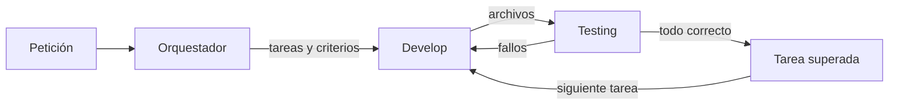

# Agent Trio

Equipo de tres agentes de IA que recibe una petición sobre una app Next.js con TypeScript, la divide en tareas, la implementa y la prueba hasta que todo pasa. El panel muestra en directo qué hace cada agente y en qué estado está cada tarea.

## Cómo funciona



| Agente | Proveedor | Modelo por defecto | Función |
| --- | --- | --- | --- |
| Orquestador | Gemini AI Studio | `gemini-3.6-flash` | Divide la petición en tareas con criterios verificables |
| Develop | Groq | `openai/gpt-oss-120b` | Crea o modifica los archivos de cada tarea |
| Testing | OpenRouter | `nvidia/nemotron-3.5-super-vl:free` | Revisa el código tras las comprobaciones automáticas |
| Respaldo | Mistral | `codestral-latest` | Continúa si un proveedor falla o agota su cuota |

Testing combina dos capas. Primero compila el proyecto generado con el compilador de TypeScript en modo estricto y analiza su AST: rutas, componentes, textos, enlaces rotos, estructura, dependencias y etiquetas de formulario. Si todo pasa, un modelo revisa el código. Cada tarea admite hasta tres intentos.

## Decisiones técnicas

- **Motor reanudable:** cada paso de agente es una petición corta que guarda su estado en Neon, compatible con los límites de funciones de Vercel. Un bloqueo con caducidad impide que dos pestañas ejecuten el mismo paso.
- **Resiliencia:** los errores de cuota o disponibilidad pasan al modelo de respaldo y después se reintentan con espera.
- **Vista previa de Next.js:** los componentes TSX generados se ejecutan en el navegador con un runtime propio que resuelve el App Router, `next/link`, `next/image` y `next/navigation`. Es una simulación ligera para la demo: no ejecuta funciones de servidor ni un build completo de Next.js.
- **Seguridad:** las claves solo existen en variables de entorno. Lanzar agentes requiere sesión, hay un límite diario y el código generado nunca se ejecuta en el servidor. Se muestra en un iframe aislado con CSP, sin acceso a red ni a la aplicación.
- **Accesibilidad:** interfaz orientada a WCAG 2.2 AA, con navegación por teclado, foco visible, estados anunciados a lectores de pantalla, objetivos táctiles amplios, modo oscuro y movimiento reducido.

## Stack

Next.js 16, React 19, TypeScript, Tailwind CSS 4, AI SDK, Neon Postgres, Drizzle ORM, Vitest, Playwright y axe-core.

## Puesta en marcha

```bash
pnpm install
cp .env.example .env.local
pnpm db:migrate
pnpm dev
```

`AUTH_SECRET` debe tener al menos 32 caracteres. `DEMO_USER` y `DEMO_PASSWORD` definen el usuario de prueba.

## Verificación

```bash
pnpm lint
pnpm typecheck
pnpm test
E2E_BASE_URL=http://localhost:3000 pnpm test:e2e
```

Las pruebas end-to-end auditan WCAG 2.2 AA con axe en 320, 768 y 1440 px, en tema claro y oscuro, además del login, la protección de la API y la navegación por teclado. La auditoría automática no sustituye una revisión manual con lector de pantalla.

## Uso de Claude Code

La aplicación se ha programado con Claude Code bajo supervisión humana:

- Definición de la arquitectura y del reparto de modelos a partir de los requisitos.
- Implementación del motor, los agentes, la base de datos y la interfaz.
- Diagnóstico con peticiones reales a cada proveedor para elegir modelos disponibles en sus planes gratuitos.
- Verificación con ejecuciones reales, pruebas unitarias, pruebas end-to-end y auditoría de accesibilidad.

Los commits en los que ha participado incluyen a Claude como coautor.
